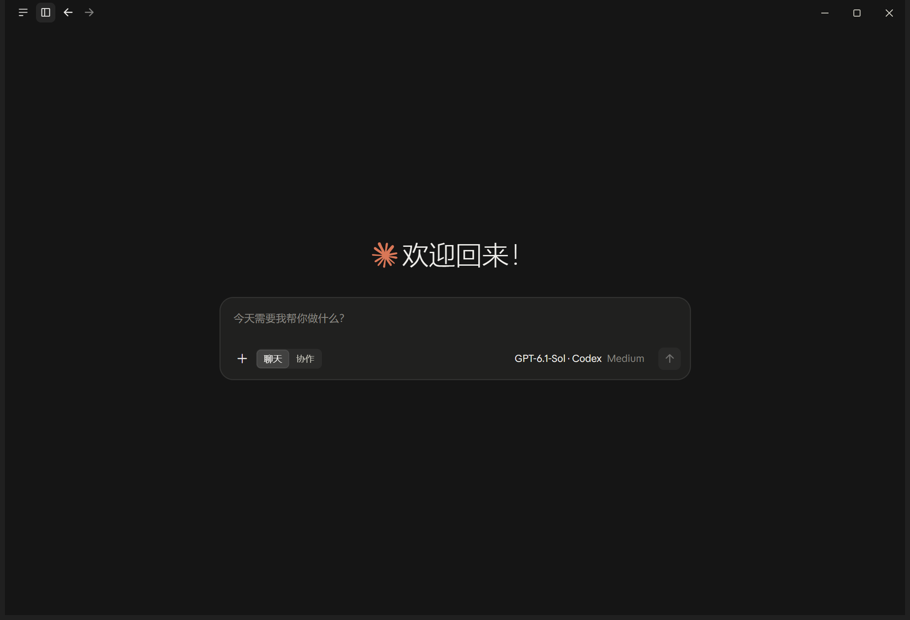
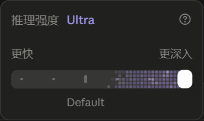
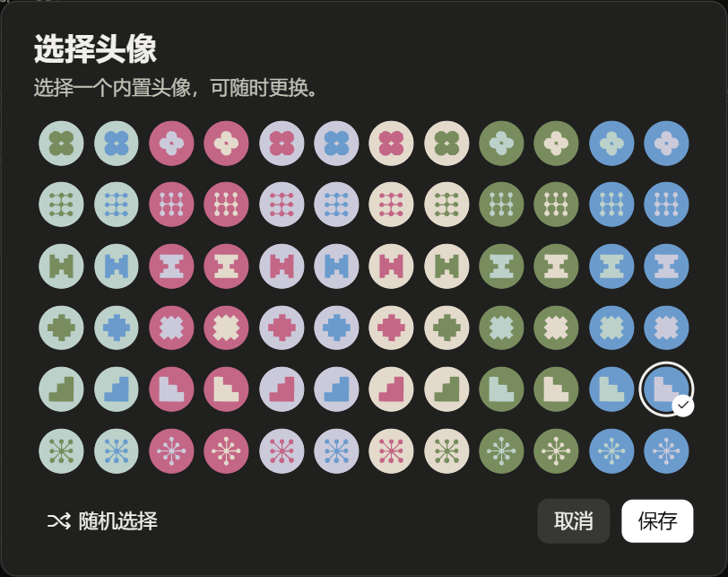
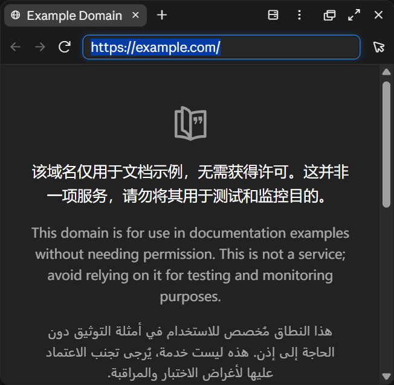

# Claude Desktop Gateway Enhancer

**让 Claude Desktop 的 Gateway 模式拥有更接近账号登录后的界面与本地功能。Magpie 可用，也可以完全不用 Magpie。**

[](https://github.com/Links2008/claude-desktop-gateway-enhancer/actions/workflows/test.yml)
[](https://github.com/Links2008/claude-desktop-gateway-enhancer/releases)
[](LICENSE)


这是一个**社区本地增强补丁插件**。它复用原版客户端已有的组件和能力，在 Gateway 接入模式下补齐中文、头像选择器及部分默认关闭的本地功能，并提供可选的原生 Ultra 接入。

它不是 Claude 官方插件市场扩展，不提供账号、API Key、模型服务或会员权益。**保留原版安装和 Chat、Cowork、Code，不需要使用缺功能的复制版客户端。**

## 应用截图

以下为 Windows 上原版客户端的实际运行截图。截图隐藏了个人列表，测试内容仅为独立验收数据。

### 中文首页与聊天 / 协作



### 原生 Ultra：最高档紫色横条



静态截图只展示动效的一帧。实机验证中，Low 至 Max 没有紫色，只有 Ultra 出现动态紫色滑轨。

### 原版内置头像选择器



### 内置浏览器



## 它能做什么

| 功能 | 本插件的处理 | 适用范围 |
| --- | --- | --- |
| 简体中文 | 增加 1701 条常用界面翻译；其余消息保留原版英文回退 | 支持的 Gateway 配置 |
| 头像 | 在账号位置显示头像，并复用原版 72 款选择器和原生保存接口 | 支持的 Gateway 配置 |
| 显示名称 | 可用 `-Name` 自定义，例如 Links；不改 Windows 用户名 | 可选 |
| Chat / Cowork / Code | 开启前两者的官方配置，保留原安装身份和 Code | 保留既有权限策略 |
| 内置浏览器 | 开启原版 `builtinBrowserEnabled`，保留网站确认 | 需现有网络策略允许 |
| 聊天文件分析 | 开启 `chatAdvancedFileAnalysisEnabled`，使用本地沙箱分析文件、生成可下载结果 | 需原版工作区虚拟机可用 |
| 文件预览 | 对本项目遇到的无效 `j` 覆盖值恢复默认；有效自建预览地址保留 | 已存在该异常时 |
| 原生 Ultra | 把已经实测的引擎工作流能力接回滑块，修复选中状态，并保留原生 WebGL 动效 | 仅下述已验证组合，需显式启用 |
| 桌面快捷方式 | 可选脚本创建原 MSIX 入口，不覆盖已有快捷方式 | 原版 MSIX 安装 |
| 安装和回滚 | 版本 / 哈希检查、安装预览、本机备份、按设置键恢复 | 不上传本机备份 |

项目、成果、定时任务、技能、连接器和插件页面本来就在原版中；本插件补充它们的常用中文，**不把“入口可见”冒充“所有服务已接通”**。

## 兼容版本

| 项目 | 已验证版本 / 条件 |
| --- | --- |
| 操作系统 | Windows 11 x64 |
| Claude Desktop | **2.42304.0** |
| MSIX 包版本 | **2.42304.0.0** |
| 安装标识 | `Claude_pzs8sxrjxfjjc` |
| Node.js | **22 或更新版本**，无额外 npm 依赖 |
| Magpie | **可选**；实测版本 0.1.1285 |
| 可选 Ultra 引擎 | 原版嵌入 Claude Code **2.1.299** |
| 可选 Ultra 模型标识 | **`codex/gpt-6.1-sol`** |

**其他 Claude Desktop 版本暂不兼容。** 即使界面看起来相似，脚本文件和锚点也可能不同。安装器会验证 6 个相关脚本的原始或已知安装哈希；不匹配时停止，没有强制跨版本安装选项。

### Ultra 到底是什么？

这里的 Ultra 是 Claude Code 的原生 `ultracode` 工作流模式：**`xhigh` 推理强度 + `ultracode: true`**，可由引擎执行动态工作流。它不是把普通 Max 改名，也不是给 GPT API 虚构一个新的推理等级。

- 默认安装不额外启用 Ultra；使用 `-Ultra` 才安装这部分适配，并在用户 Claude Code 设置中启用工作流。
- 当前适配严格限定实测模型和本机引擎，保留管理员禁用工作流、未确认管理设置、传输能力和远程连接限制。
- 其他 Gateway / 模型可以使用中文、头像和本地功能，但**不能据此推断 Ultra 也适用**。
- 在实机桌面中，原生 Workflow 的两个子任务分别返回 4 和 6；切回 Max 后，原生 `ultracode` 状态变为 false。
- Ultra 可能产生多个子任务，增加模型用量。工作流权限请求仍由原版处理。

## 不使用 Magpie，怎么接入？

**可以。这个插件不依赖 Magpie 进程或 Magpie 登录。**

1. 在原版 Claude Desktop 的第三方推理配置窗口中，选择 **Gateway**。官方英文入口为 Developer → Configure Third-Party Inference。
2. 填写你自己的网关地址、认证方式及模型配置。网关需要满足 Claude Desktop 的接口约定，通常提供兼容 Anthropic Messages 的推理接口和模型发现能力。
3. 先验证原版客户端通过该网关能够正常对话，再安装本插件。

直接把任意 OpenAI `/v1/chat/completions` 地址填进去，并不意味着 Claude Desktop 就能使用。若上游只提供 OpenAI 接口，需要由你选择的网关完成兼容转换。本插件**只增强客户端，不承担推理协议转换**。

若使用 Magpie，可先按 [Magpie 官方说明](https://github.com/yetone/magpie)完成桌面 Gateway 配置，再执行下方安装。现有凭据、模型路由和网关地址保留，不写入项目或上传到 GitHub。

参考：[Claude Desktop 第三方配置](https://claude.com/docs/third-party/claude-desktop/configuration)。

## 安装

### 1. 下载并准备

从 [Releases](https://github.com/Links2008/claude-desktop-gateway-enhancer/releases) 下载 `claude-desktop-gateway-enhancer-0.1.0.zip`，解压到普通文件夹。也可以克隆本仓库。

安装 [Node.js 22+](https://nodejs.org/)，然后在解压目录打开 PowerShell：

```powershell
node --version
node .\src\cli.mjs doctor
```

`doctor` 仅检查版本、文件哈希、语言占位符和当前 Gateway 配置，不修改文件。无需运行 `npm install`。

### 2. 预览将要安装的内容

```powershell
node .\src\cli.mjs install --dry-run
```

如果需要已验证组合的 Ultra 和自定义名称：

```powershell
node .\src\cli.mjs install --dry-run --ultra --name "Links"
```

### 3. 保存工作，从托盘正常退出 Claude，再安装

```powershell
# 中文、头像、Chat / Cowork、浏览器与文件分析
node .\src\cli.mjs install

# 或者：同时启用已验证组合的 Ultra，并设置显示名称
node .\src\cli.mjs install --ultra --name "Links"
```

两条安装命令选择一条。安装后从原版快捷方式启动 Claude。

也提供 PowerShell 入口：

```powershell
.\Enhancer.ps1 -Action doctor
.\Enhancer.ps1 -Action install -DryRun -Ultra -Name "Links"
.\Enhancer.ps1 -Action install -Ultra -Name "Links"
```

若本机策略不允许执行 `.ps1`，可直接使用上述 `node` 命令，无需修改系统执行策略。

**写入权限：** MSIX 的 WindowsApps 目录可能受到保护。若提示拒绝访问，请停止并检查目标资源的写入权限；必要时在管理员终端重试。管理员身份也不保证目录可写。工具不会接管目录所有权、更改 ACL、修改签名或关闭系统保护。不要对整个 WindowsApps 递归修改权限。当前发行版对可写的原版资源安装已验证，其他保护配置可能需要自行处理。

### 4. 头像、名称和桌面快捷方式

- **头像：** 点击账号菜单 → 设置 → 通用 → 点击头像 → 从 72 款内置头像中选择 → 保存。
- **名称：** 安装时使用 `--name "你的名称"`；同时关闭界面中的终端用户归属显示，使用部署名称。不传则保留现有名称和归属设置，不改系统账户。
- **快捷方式：** 在 PowerShell 执行 `./Create-Shortcut.ps1`，指向原版 AppsFolder 入口；已有 `Claude.lnk` 时保留原文件。

### 高级参数

```powershell
node .\src\cli.mjs install --dry-run `
  --app-root "C:\你的原版安装目录\app" `
  --profile "$env:LOCALAPPDATA\Claude-3p\configLibrary\你的配置ID.json" `
  --state-dir "$env:LOCALAPPDATA\ClaudeGatewayEnhancer\my-backup"
```

`--app-root` 依然检查程序版本与资源哈希，不用于绕过兼容性限制。默认读取 `configLibrary/_meta.json` 中当前应用的配置，不假设你使用 Magpie 的配置 ID。

## 卸载与升级

保存工作并正常退出 Claude：

```powershell
node .\src\cli.mjs uninstall --dry-run
node .\src\cli.mjs uninstall
```

默认备份位于 `%LOCALAPPDATA%\ClaudeGatewayEnhancer\0.1.0`。若安装时指定了 `--state-dir`，卸载时使用同一路径。

卸载恢复**插件安装前的资源**和本插件改动过的设置键，保留会话、凭据及其他配置。假如安装前已经手工打过补丁，卸载会恢复到手工补丁状态。快捷方式是单独的可选工具生成的，需要时手工删除桌面 `Claude.lnk`。

- 不要删除或公开本机备份；其中含客户端原始资源和少量本地设置差异。
- 客户端升级后可能覆盖补丁。**不要用旧备份覆盖新版本**；哈希不匹配时卸载器会停止。
- 同一备份目录不重复覆盖。已卸载后再次安装，请指定一个新的空备份目录。
- 如果安装或卸载失败，工具会尝试撤回本次写入，并保留事务记录。出现 `recovery-required` 时先检查备份，不要删除现场或反复覆盖。

## 验证与已知边界

本次发布包含 12 项自动测试，以及基于本机原版资源隔离副本的安装 / 重复检查 / 卸载验证。详细记录见 [验证说明](docs/verification.md) 和 [验证数据](docs/verification.json)。

```powershell
npm test
```

实际运行验证包括：Chat、Cowork 回复；原生 Workflow 执行；Ultra 独占紫色动效；头像保存和重载；内置浏览器打开网页；聊天本地沙箱生成内容为 `LOCAL_ANALYSIS_OK 60` 的真实文本文件。

| 仍有的差异 | 说明 |
| --- | --- |
| 官方账号云端功能 | 官方云会话、网页 / 手机同步、用户间共享、语音等不由本插件提供 |
| 网页搜索 | 需要网关转发原生工具，或另外配置搜索服务；没有附送搜索凭据 |
| 外部连接器 | 需要用户自己的账号授权；显示入口不代表自动连接 |
| 定时任务 | 使用原版已有功能，需要电脑在线且保持唤醒；本项目未创建或实测自动定时触发 |
| 中文覆盖 | 常用界面 1701 条，部分动态提示、内置技能内容和模型输出仍可能为英文 |
| 模型能力 | 上游模型、网关转换和工具兼容性仍会影响实际体验 |

目标是 **Gateway 模式下尽量接近登录版的界面和本地功能**，不是承诺两种部署完全等价。官方边界见 [第三方功能表](https://claude.com/docs/third-party/claude-desktop/feature-matrix)。

连接故障提示：Gateway 地址不等于 HTTP 网络代理；不要把普通推理端点误填为 `egressProxyUrl`。认证方式也应与自己的服务一致，已有的 Key 不应误配为交互式 SSO。这些连接设置由使用者或网关工具配置，本插件不会重写凭据、认证或网络代理。

## 项目内容与隐私

```text
src/             安装器、事务恢复逻辑及最小补丁规则
locales/         1701 条中文增量资源
docs/            兼容性、验证说明和真实应用截图
test/            不含原版代码或真实凭据的测试
Enhancer.ps1     PowerShell 命令入口
Create-Shortcut.ps1 原版桌面快捷方式工具
```

安装器没有联网请求，不上传配置、会话或备份。原版 Claude、网关和浏览器自身的网络行为由其各自设置决定。仓库不包含 Claude.exe、app.asar、完整原版脚本、用户配置或登录凭据；安装时在使用者自己的电脑读取原版资源。

## 问题反馈与贡献

欢迎提交 [Issue](https://github.com/Links2008/claude-desktop-gateway-enhancer/issues)。请说明 Windows 版本、Claude Desktop 版本、是否使用 Ultra，以及不含秘密的错误文字。**不要上传 API Key、完整配置、会话、原版资源或本机备份。**

新版本适配必须重新定位原生接口、校验文件哈希，并实际验证安装、回滚和核心功能。不能只改版本号或移除检查。贡献说明见 [CONTRIBUTING.md](CONTRIBUTING.md)。

作者：[Links2008](https://github.com/Links2008)。本项目与 Anthropic、OpenAI、Magpie 无官方隶属关系。原创工具代码和中文资源以 [MIT](LICENSE) 发布；原客户端、商标与原生组件归其各自权利人，见 [NOTICE](NOTICE)。
